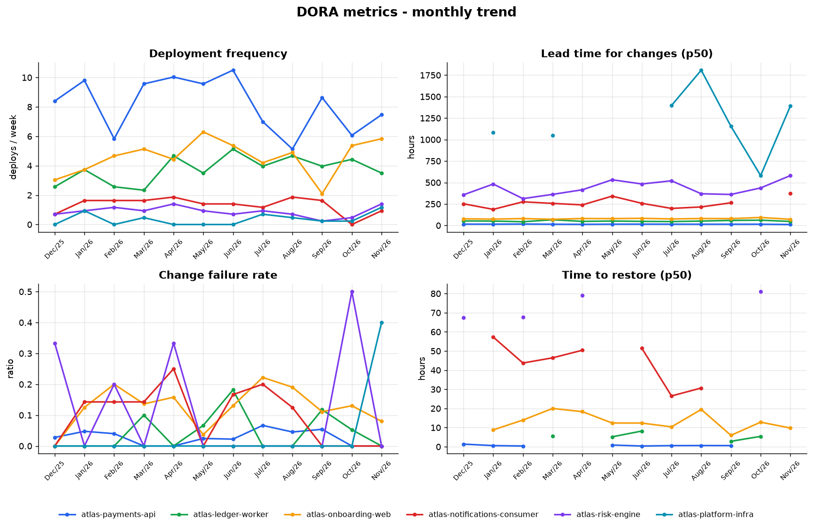

<div align="center">

# 🎼 Maestro

**AI-native engineering management toolkit — MCP · RAG · agents · DORA**

[](https://github.com/bife29/maestro/actions/workflows/ci.yml)
[](https://bife29.github.io/maestro/)
[](pyproject.toml)
[](LICENSE)
[](https://github.com/astral-sh/ruff)
[](specs/PLAN.md)

> 🚧 **Em construção — Fases 0 e 1 de 6 concluídas.** Acompanhe o progresso em [`specs/TASKS.md`](specs/TASKS.md).

</div>

---

## Por que isto existe

Coordenar times de engenharia hoje é coordenar **pessoas e agentes**. Nos últimos anos construí, no dia a dia,
um conjunto de práticas para isso: servidores **MCP** que deixam a esteira consultável em linguagem natural,
uma base de conhecimento **RAG** que preserva decisões e incidentes, **agentes que revisam PRs** contra um padrão
arquitetural e um baseline de segurança — com schema, auditoria e humano no circuito —, **métricas DORA** geradas
automaticamente e um fluxo **SDD** (constitution → SPEC → PLAN → TASKS) que disciplina o trabalho dos agentes.

O Maestro reúne essas práticas em um toolkit **genérico, reproduzível e auditável**. Tudo roda **offline, sem
credencial**, sobre um dataset sintético gerado pelo próprio projeto. Integrações reais (GitHub, Azure DevOps,
LLMs) são opcionais.

## Quick start

```bash
git clone https://github.com/bife29/maestro && cd maestro
python -m venv .venv && . .venv/bin/activate      # Windows: .venv\Scripts\activate
pip install -e ".[dev]"
maestro demo        # seed → métricas DORA → fluxo de PR → 4 gráficos em docs/assets/charts/
```

```text
maestro seed                      # 6 repositórios sintéticos, 12 meses, determinístico (--seed 42)
maestro metrics dora [--json]     # deploys/semana · lead time p50 · CFR · MTTR + nível Elite/High/Medium/Low
maestro metrics pr-flow           # 1ª revisão p50 · ciclo · tamanho · retrabalho · % revisadas por IA
maestro charts                    # PNGs: tendência DORA, distribuição de PR, heatmap de deploys, funil
maestro doctor                    # checa Python, config e providers
```



> O "Overall" é o **pior** dos quatro níveis — um time é tão rápido quanto sua capacidade mais lenta. A regra é
> deliberada e documentada em [`domain/metrics.py`](src/maestro/domain/metrics.py).

## Mapa de competências → módulos

| Competência | Onde está | Fase |
|---|---|---|
| **Métricas DORA & fluxo de PR** | `application/dora.py`, `application/pr_flow.py`, gráficos em `docs/assets/charts/` | 1 |
| **RAG / base de conhecimento** | `infrastructure/kb/sqlite_fts5` (BM25, chunking por heading, filtros) | 2 |
| **MCP (Model Context Protocol)** | `presentation/mcp/server.py` + `tools.yaml` (allow-list, read-only, audit) | 3 |
| **Orquestração de agentes com governança** | `application/review_pipeline.py` (state machine, gate de porte, schema, dry-run, aviso de IA) | 4 |
| **Segurança de agentes** | prompt-injection suite, auditoria append-only, limites de custo/chamadas | 4 |
| **Clean Architecture & qualidade** | `import-linter`, mypy strict no domínio, hypothesis, ruff, gitleaks, pip-audit | 0 |
| **SDD — Spec-Driven Development** | [`specs/`](specs/) · [`AGENTS.md`](AGENTS.md) · `.github/agents` · `.github/instructions` | 0, 4 |
| **Integrações plugáveis** | providers `local` · `github` · `azure_devops` · LLM `dry` · `openai_compatible` · `bedrock` | 6 |

## Roadmap

| Fase | Entrega | Status |
|---|---|---|
| 0 | Fundação: esqueleto Clean Arch, CI, qualidade, specs | ✅ 24/11 |
| 1 | `seed` · `metrics dora` · `metrics pr-flow` · `charts` · `demo` — cobertura 95% | ✅ 25/11 |
| 2 | `kb index/ask/status/note` | ⏳ |
| 3 | `mcp serve` (6 tools, allow-list, audit) | ⏳ |
| 4 | `review` — agente de code review governado | ⏳ |
| 5 | Wiki (MkDocs Material + Pages), README final | ⏳ |
| 6 | Integrações reais opcionais (GitHub, LLMs) | ⏳ |

## Governança

Este projeto aplica um baseline de requisitos não-funcionais para plataformas com agentes de IA — allow-list de
tools, saída validada por schema, human-in-the-loop, auditoria append-only, log sem PII, timeout/retry em toda
integração, scanner de segredos em CI. A tabela completa está em
[`specs/constitution.md §4`](specs/constitution.md).

**Nenhum dado real** de qualquer organização está neste repositório: repositórios, pessoas, incidentes e documentos
são sintéticos (`atlas-*`), gerados de forma determinística por `maestro seed`.

---

<details>
<summary><b>English summary</b></summary>

**Maestro** is an AI-native engineering management toolkit: an MCP server exposing engineering data to LLM
clients, a lightweight RAG knowledge base (SQLite FTS5), a governed code-review agent pipeline (size gate, schema
validation, dry-run by default, append-only audit, prompt-injection tests), DORA metrics with charts, and a
Spec-Driven Development workflow for agents. Everything runs offline on synthetic data; real integrations
(GitHub, Azure DevOps, OpenAI-compatible, Bedrock) are optional. Built with Clean Architecture enforced by
`import-linter`, typed with mypy, tested with pytest + hypothesis.

</details>

<sub>Feito por <a href="https://www.linkedin.com/in/michel-bueno-9309b712b">Michel Bueno</a> · MIT</sub>
